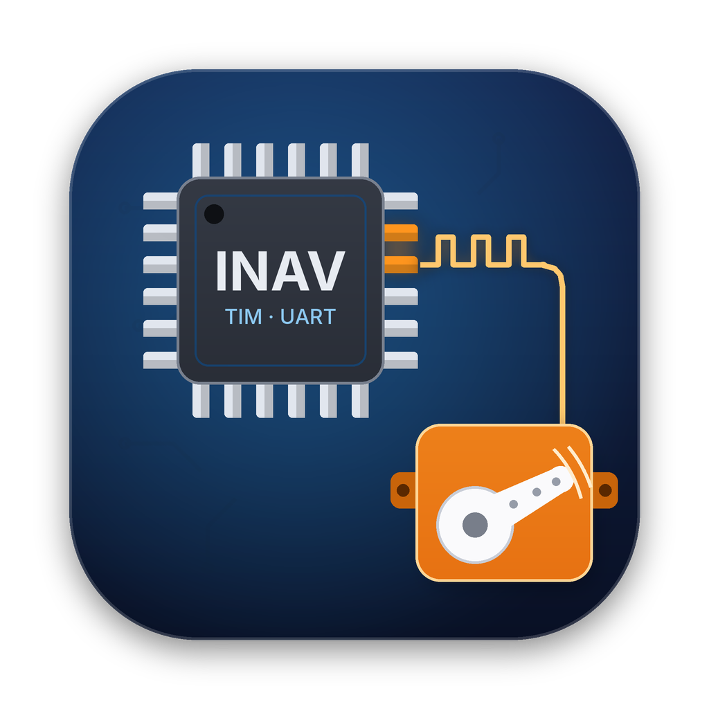

<p align="center"></p>

# INAV Servo Support Assistant (macOS)

A native macOS app (SwiftUI + Metal) that adds **servo outputs on UART and LED-strip pads** to an inav
flight-controller target. It reads the target's `target.h` / `target.c`, checks every UART pin and the
LED pad against the MCU's timer alternate-function table, shows which pads are possible candidates,
lets you choose pads and timer channels, checks which of the remaining UARTs can still take a
receiver, GPS and VTX, and then edits `target.c` / `target.h`.

## Build & run

Requires macOS 13 (Ventura) or newer and Xcode *or* the Command Line Tools (`xcode-select --install`).

```bash
git clone https://github.com/lydianb79/INAV-Servo-Support-Assistant.git
cd INAV-Servo-Support-Assistant
./build_app.sh --run          # builds "INAV Servo Support Assistant.app" here and launches it
```

Other options: `./build_app.sh --universal` (arm64 + x86_64, needs full Xcode).
You can also open `Package.swift` in Xcode and press ⌘R.

The Metal shaders are compiled at runtime from source (`MTLDevice.makeLibrary(source:)`),
so the separate `metal` compiler from full Xcode is **not** needed.

## Workflow

1. **Source** – at launch a start screen offers *Continue* with the last source, the list of recent
   sources, *Open other inav folder…* and *Clone…*. While the app is open the same choices are in the
   **Source** toolbar menu, the **Change** menu in the sidebar header, and the File menu
   (⌘O open, ⇧⌘N clone, ⇧⌘0 start screen). Cloning again proposes a free folder name (`inav-2`, …),
   so an existing checkout is never overwritten.
2. **Target** – choose a board from `src/main/target/` in the sidebar (filter by name or MCU).
3. **Analysis** – the app shows
   * a Metal-rendered GPIO map (ports × pins): green = UART pad that can be a servo,
     blue = existing motor/servo output, purple = UART without usable timer, orange pulse = selected;
     hover for details, click a green pad to select it,
   * one card per UART with the timer options for TX and RX, all detected conflicts and the
     rejected options with the reason.
4. **Select** – tick UART(s), the LED pad or individual pads, pick the timer channel and the mode:
   * **UART shared** – UART stays defined. inav's `checkPwmTimerConflicts()` skips the timer output
     while the UART has a function in the Ports tab, so the pad works as UART *or* servo.
   * **UART dedicated** – the `USE_UARTn` / `UARTn_*` defines are commented out and `SERIAL_PORT_COUNT`
     is reduced. Required for UART1, which inav's runtime check does not cover.
   * **LED shared** – `TIM_USE_SERVO` is added next to `TIM_USE_LED`: servo while the LED_STRIP
     feature is off, LED strip output when it is on.
   * **LED dedicated** – `TIM_USE_LED` is replaced by `TIM_USE_SERVO`, `USE_LED_STRIP` / `WS2811_*`
     are commented out and `FEATURE_LED_STRIP` is removed from `DEFAULT_FEATURES`.
5. **Remaining serial ports** – choose the receiver (CRSF/ELRS or SBUS), GPS and VTX
   (SmartAudio/Tramp or MSP DisplayPort). The table lists every UART and softserial port with its
   state after your selection and ✓ / ⚠ / ✗ per peripheral, and a suggested assignment is computed:
   * CRSF/ELRS, GPS, MSP DisplayPort need TX + RX (RX only → ⚠ no telemetry / no GPS config)
   * SBUS needs RX; on STM32F4 only UARTs with an `INVERTER_PIN_UARTn_RX` are ✓ (F7/H7/AT32 invert internally)
   * SmartAudio/Tramp needs a TX pin and also works on softserial
   * softserial that shares pins with a UART cannot be used together with that UART
6. **Review & Apply** – diff of `target.c` and `target.h`; on apply, backups
   `target.c.servo-backup` / `target.h.servo-backup` are written once. *Revert to Backup* restores them.
7. **Test Build** (optional) – runs `cmake .. && make <TARGET>` in `<inav>/build` (needs `cmake`).
   inav's cmake downloads the ARM compiler into `<inav>/downloads` and `<inav>/tools`; the app links both
   folders to one shared cache (`~/Library/Application Support/INAV Servo Support Assistant/toolchain`), so the
   compiler is downloaded only once, however often the inav folder is re-cloned. *File → Show ARM Toolchain
   Cache in Finder* opens it.

## What gets changed

`target.c` – new entries are appended at the end of `timerHardware[]` so existing output
numbering is unchanged:

```c
    // Servo outputs on UART pads – added by INAV Servo Support Assistant
    DEF_TIM(TIM9, CH2, PA3,    TIM_USE_SERVO, 0, 0), // UART2 RX pad -> servo (INAV Servo Support Assistant)
```

If the pad already has a `DEF_TIM` line (e.g. `TIM_USE_PWM` or a softserial `TIM_USE_ANY`),
`TIM_USE_SERVO` is added to that line instead of creating a duplicate.

`target.h` – `MAX_PWM_OUTPUT_PORTS` is raised by the number of new outputs; in dedicated mode the UART
is disabled and `SERIAL_PORT_COUNT` is decreased.

After flashing: turn on "Enable motor and servo output" (CLI `feature PWM_OUTPUT_ENABLE`, then `save`) –
no inav target enables it by default and without it servo outputs are not started. Then assign the servo outputs in the Mixer, and set
`timer_output_mode` for that timer to `SERVOS` if the timer is shared with auto outputs.

## How candidates are determined

| MCU | Pin → timer source |
|-----|--------------------|
| STM32F405 / F427 | embedded table from ST DS8626 / DS9405 (alternate function mapping) |
| STM32F411 | embedded table from ST DS10314 (TIM1-5, 9-11 only) |
| STM32F722 / F745 / F765 | inav `drivers/timer_def_stm32f7xx.h` AF table, cross-checked against the datasheet table |
| STM32H743 | inav `drivers/timer_def_stm32h7xx.h` AF table |
| AT32F435/437 | inav `drivers/timer_def_at32f43x.h` MUX table |

Every option is also validated against what inav can compile: the timer must exist in
`drivers/timer_<mcu>.c`, and `DEF_TIM_DMA__BTCH_<TIMx_CHy>` (plus the `DEF_TIM_AF__` entry on
F7/H7/AT32) must exist – otherwise `DEF_TIM()` would not build. Options the datasheet allows
but inav's tables lack are listed as rejected with the reason.

Conflict checks (blocking ✖ / warning ⚠):

* ⚠ timer drives motor outputs (motor-only or auto motor/servo) – motors and servos cannot share a timer in inav,
  so using that pad **disables those motor outputs** (their `DEF_TIM` lines are commented out). The *Motor outputs*
  strip shows motors 1, 2, 3, 4 … and which of them are still usable; options that keep all motors are preferred,
  and a selection that would disable every motor output is blocked
* ✖ the same timer channel is already used on another pin, or selected twice
* ✖ pin is an ADC channel
* ⚠ timer shared with the LED strip, beeper, PPM/PWM input or softserial
* ⚠ pin referenced by other defines (I2C, BIND_PIN, …), default receiver UART, UART1 in shared mode
* ℹ complementary (CHxN) channel

`Tools/servo_engine_reference.py` is a Python reference of the analysis engine
(`python3 Tools/servo_engine_reference.py ~/Desktop/inav [TARGET]`) used to validate the logic
against all targets.

## App icon

`AppIcon.png` (1024×1024) is picked up automatically by `build_app.sh` and converted to `AppIcon.icns`.
It is generated by `Tools/make_icon.py` (Python + Pillow): `python3 Tools/make_icon.py AppIcon.png`.

## Project layout

```
Package.swift
build_app.sh
Sources/INAVServoSupport/
  App/      INAVServoSupportApp.swift, AppState.swift
  Engine/   ChipDatabase (datasheet tables), TargetParser, Analyzer, Patcher (+ line diff), PortPlanner, ProcessRunner
  Metal/    GPIORenderer (MTKView + runtime-compiled shaders), GPIOMapView
  Views/    ContentView, SidebarView, TargetDetailView, PortPlanSection, SourceViews (start screen, source menu), Sheets
AppIcon.png
Tools/servo_engine_reference.py   Python reference of the analysis/patch engine
Tools/make_icon.py                renders AppIcon.png
```

## License

Copyright (C) 2026 lydianb79

This program is free software: you can redistribute it and/or modify it under the terms of the
GNU General Public License as published by the Free Software Foundation, either version 3 of the
License, or (at your option) any later version – the same license as inav itself.
See [LICENSE](LICENSE) for the full text.

This program is distributed in the hope that it will be useful, but WITHOUT ANY WARRANTY; without
even the implied warranty of MERCHANTABILITY or FITNESS FOR A PARTICULAR PURPOSE.
